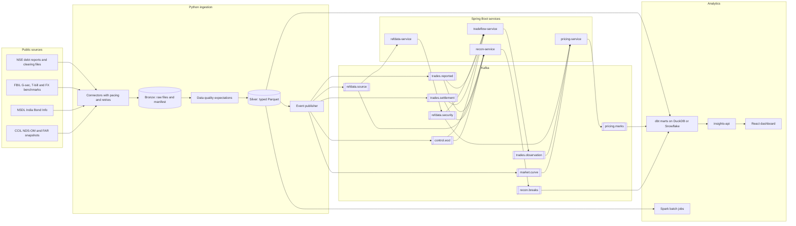

# Hallmark: Evaluated Pricing for Indian Corporate Credit

Hallmark produces daily evaluated marks for Indian corporate bonds and NCDs, follows each trade from exchange reporting to clearing settlement, and reconciles the public data sources against each other. It runs only on public market data: NSE debt segment reports and clearing settlement files, FBIL benchmark curves and NSDL depository reference data. No value in the repository or the dashboard is simulated.

## Context

Corporate credit in India is mostly held to maturity and rarely traded. On a typical day in 2025 and 2026 about 420 bond ISINs traded on NSE, out of roughly 26,000 outstanding (NSDL, March 2026 quarter). Private credit is commonly structured as listed or unlisted NCDs, and the institutions that hold them still need a defensible daily value for each position. In 2026 one of the largest global private credit managers moved its credit portfolios to daily pricing benchmarked to public market data, which raises the bar for marks that can be traced back to observable trades.

Hallmark addresses three questions for this market:

1. **Valuation.** What is a defensible price today for a bond that has not traded today, and how good is that price when the bond does trade?
2. **Trade flow and control.** Does every reported trade settle, and do the depository, exchange and benchmark sources agree with each other?
3. **Distribution.** Which parts of the credit market reach individual investors through retail denominations and online bond platforms, and at what credit quality?

## Results on real data

| Measure | Result |
|---|---|
| History ingested | 193,754 reported trade rows, 265,299 settlement rows, 1 Jan 2025 to 14 Oct 2026 |
| Reference data | 7,107 golden security records from NSDL and NSE, 3,803 eligible for pricing |
| Daily marks | 1,740 marks per valuation day on average over 132 days (April to October 2026) |
| G-sec convention check | All 119 fixed-coupon G-secs in the FBIL valuation of 8 October 2026 reprice from FBIL's yield within 0.0006 per 100 |
| NSE yield reproduction | 84.8% of reported trades match within 25 bp; differences are classified by cause |
| Out-of-sample marks | Median absolute error 7.4 bp for bonds that traded in the previous 30 days (12,640 trades, July to October 2026) |
| Confidence calibration | Median error 6.3 bp at confidence 0.8 and above, 55 bp below 0.4 |
| Trade to settlement | 94.6% of bond trade dates reconcile; 876 settlement fails and 1,997 partial settlements identified |

The full set of findings, including where the model does not beat a naive baseline, is in [docs/findings.md](docs/findings.md).

## Architecture



Each service owns its schema, consumes events idempotently and publishes its outputs. Detailed diagrams, the event catalogue and the end-of-day sequence are in [docs/architecture.md](docs/architecture.md).

## Repository layout

| Path | Contents |
|---|---|
| `ingest/` | Python package: connectors, bronze and silver lake, data quality, event publishing, Kafka sink |
| `contracts/` | JSON Schemas for every event, real examples and two complete replay days |
| `services/` | Maven multi-module: `bond-math`, `platform-commons`, four Spring Boot services, `backfill` |
| `warehouse/` | dbt project with staging models, marts and data tests (DuckDB locally, Snowflake profile) |
| `analytics/spark/` | PySpark jobs: rating migration matrix and issuer liquidity |
| `insights-api/` | FastAPI read API over the warehouse marts |
| `web/` | React and TypeScript dashboard, served statically from a data snapshot |
| `deploy/` | Docker Compose stack and Kubernetes manifests (Kustomize) |
| `.github/` | CI, CD to GHCR and GitHub Pages, scheduled data refresh |
| `docs/` | Architecture, methodology, data sources, findings, runbook and decision records |

## Technology

| Area | Used for |
|---|---|
| Java 21, Spring Boot 4.1, Spring Kafka | Reference data, trade flow, pricing and reconciliation services |
| JUnit 6, AssertJ, embedded Kafka, JaCoCo | Unit, integration and contract tests with coverage gates |
| Python 3.12, Polars, DuckDB, httpx, Typer | Ingestion, normalisation, data quality and publishing |
| Kafka 4 (KRaft) | Event backbone between ingestion and services |
| PostgreSQL 16 and H2, Flyway | Service storage with versioned migrations |
| dbt, DuckDB, Snowflake | Warehouse models and tests |
| PySpark 4 | Batch analytics over the lake |
| React 19, TypeScript, Vite, Recharts | Dashboard |
| Docker, Kubernetes, GitHub Actions | Packaging, deployment and CI/CD |

## Running it

Requirements: Python 3.12, Java 21, Node 22. Docker is optional.

```bash
python -m venv .venv && .venv/bin/pip install -e "ingest[kafka,dev]"

# 1. Download and normalise public data (example: one month)
hallmark-ingest acquire --start 2026-09-01 --end 2026-09-30
hallmark-ingest transform
hallmark-ingest acquire-nsdl --since 2026-09-01
hallmark-ingest transform

# 2. Build and test the services
cd services && ./mvnw verify && cd ..

# 3. Replay the period through the service domain logic without a broker
hallmark-ingest publish --sink file --out data/exports/replay --start 2026-09-01 --end 2026-09-30
java -jar services/backfill/target/backfill-0.1.0-SNAPSHOT-exec.jar data/exports/replay data/exports/backfill
hallmark-ingest load-outputs

# 4. Warehouse, snapshot and dashboard
cd warehouse && cp profiles.example.yml profiles.yml && dbt build --profiles-dir . && cd ..
python scripts/export_snapshot.py
cd web && npm ci && npm run dev
```

To run the streaming stack with Kafka and PostgreSQL:

```bash
docker compose -f deploy/compose/docker-compose.yml up --build
docker compose -f deploy/compose/docker-compose.yml run --rm ingest publish --start 2026-10-01 --end 2026-10-14
```

The [runbook](docs/runbook.md) covers both paths, configuration and operations.

## Documentation

- [Architecture](docs/architecture.md)
- [Pricing methodology](docs/methodology/pricing.md)
- [Reconciliation controls](docs/methodology/reconciliation.md)
- [Distribution analytics](docs/methodology/distribution.md)
- [Data sources](docs/data-sources.md)
- [Data quality](docs/data-quality.md)
- [Events and contracts](docs/events.md)
- [Findings](docs/findings.md)
- [Runbook](docs/runbook.md)
- [Decision records](docs/adr)
- [Contributing](CONTRIBUTING.md)

## Data use

All inputs are files and APIs published without authentication by NSE, FBIL, NSDL and CCIL. Requests are paced and cached so that each file is fetched once. The repository stores only small slices of these files as test fixtures and an aggregated dashboard snapshot; the full lake is rebuilt locally from the sources.
