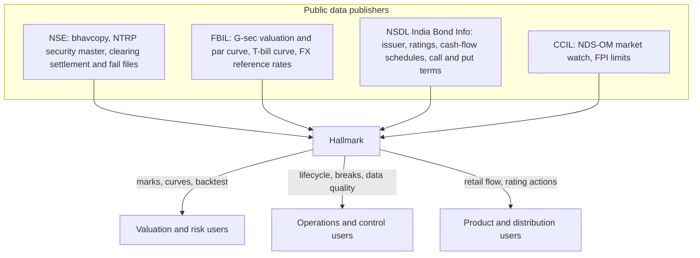
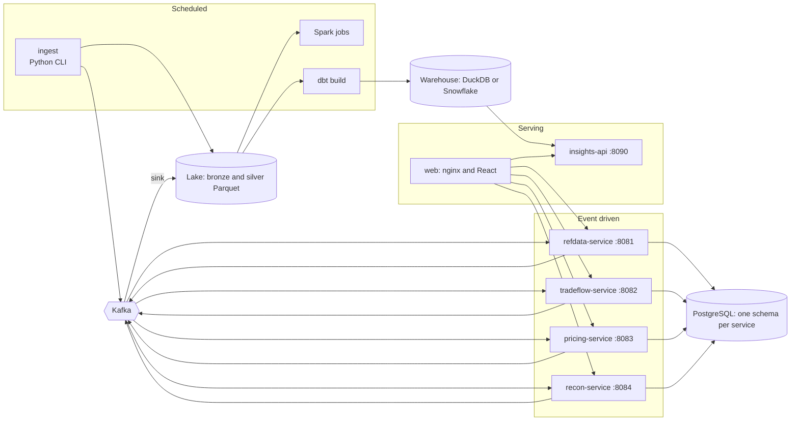
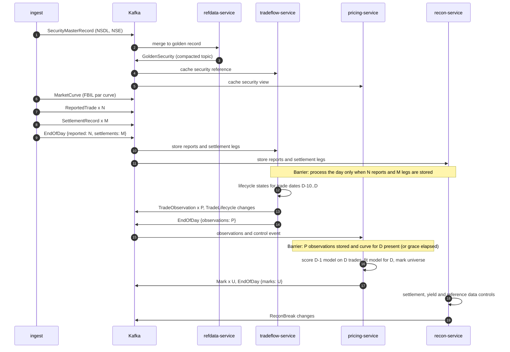
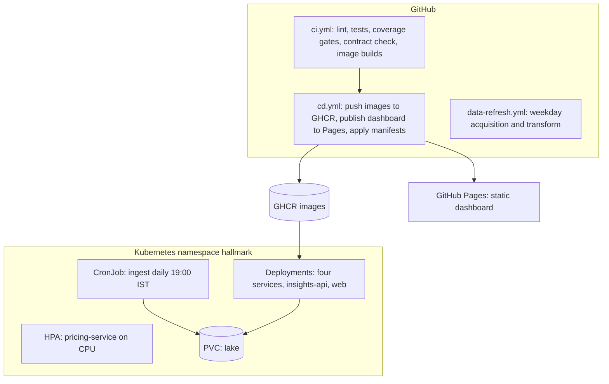

# Architecture

## System context

## Containers

| Component | Responsibility | State |
|---|---|---|
| `ingest` | Download public files with per-host pacing, keep raw bytes and a manifest, parse to typed Parquet, run data quality expectations, publish contract events, land service outputs back in the lake | Lake |
| `refdata-service` | Merge NSDL and NSE records into a golden record per ISIN with field lineage, source conflicts, issuer key, sector group, point-in-time ratings and pricing eligibility | `refdata` schema |
| `tradeflow-service` | Follow each ISIN and trade date from report to settlement, classify the lifecycle state, build validated price observations | `tradeflow` schema |
| `pricing-service` | Bootstrap the risk-free curve, fit credit curves, mark every eligible bond, score yesterday's model against today's trades | `pricing` schema |
| `recon-service` | Reconcile reported against settled trades, NSE yields against the depository schedule, and NSDL against NSE terms; manage breaks | `recon` schema |
| `insights-api` | Read API over the dbt marts | Warehouse, read only |
| `web` | Dashboard built from a JSON snapshot of the marts; its nginx also routes `/api/<service>/` to each service API | None |

## Event flow for one business date

Kafka orders messages within a partition, not across topics. A day's control event can therefore arrive before its last trade event. Every consumer that acts at end of day stores the control event, waits until the announced number of events has been stored, and then processes days strictly in date order.

## Delivery guarantees

- Producers use idempotent, `acks=all` publishing.
- Every event carries a deterministic `eventId` (SHA-256 of type, key, business date and canonical payload). Consumers record processed ids in their own schema inside the same transaction as the state change, so replays and redeliveries are absorbed.
- Downstream events are published after the database transaction commits.
- Listener errors are retried with exponential backoff. Malformed events, argument errors and SQL errors that cannot succeed on retry go straight to `<topic>.dlq` with the exception in headers. Every failed attempt is logged with topic, partition and offset.

## Storage

Each service owns one PostgreSQL schema, migrated by Flyway. The SQL is written to run unchanged on PostgreSQL 16 and on H2 in PostgreSQL mode, which the services use for local runs and tests. Upserts are expressed as update-then-insert rather than vendor-specific syntax, and aggregations that H2 plans poorly are done as two grouped queries merged in memory.

The lake has two layers:

| Layer | Format | Rules |
|---|---|---|
| Bronze | Files exactly as downloaded, partitioned by business date or snapshot date | Append-only manifest per source with URL, HTTP status, byte count and SHA-256 |
| Silver | Typed Parquet (zstd), one partition per date | Written only after the dataset's expectations pass; failing rows are quarantined |

The warehouse reads silver through a dbt macro that resolves to `read_parquet` on DuckDB and to staged tables on Snowflake.

## Batch replay

`services/backfill` runs the four services' domain logic in one process over exported event files, in the same order the streaming path uses. It reuses the services' classes as libraries (the Boot executable jars are published with an `exec` classifier). The six-month history in [findings.md](findings.md) was produced this way; the streaming path is exercised end to end on real days by each service's integration test against an embedded broker.

## Deployment

Service containers run as a non-root user with read-only root filesystems. Services expose Spring Boot liveness and readiness probes and Prometheus metrics at `/actuator/prometheus`.
