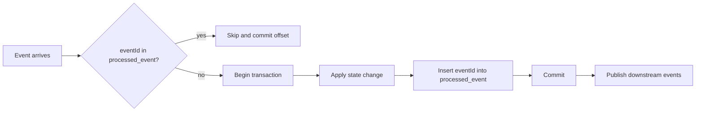

# Events and contracts

Every message on Kafka is a JSON envelope with a typed payload. The schemas in `contracts/schemas` (JSON Schema 2020-12) are the single definition of each event. They are generated from the ingest models by `scripts/gen_schemas.py` and checked in.

## Envelope

| Field | Type | Meaning |
|---|---|---|
| `eventId` | string, 64 hex characters | SHA-256 of event type, key, business date and canonical payload. The same input always produces the same id. |
| `eventType` | string | Contract name, for example `ReportedTrade` |
| `schemaVersion` | integer | Version of the payload schema |
| `source` | string | Producer, for example `hallmark-ingest` or `pricing-service` |
| `key` | string | Kafka message key |
| `businessDate` | date | The business date the event belongs to |
| `producedAt` | timestamp | When the event was produced. Not part of the id. |
| `payload` | object | Event body |

## Topics

All topic names are prefixed with `hallmark.` and suffixed with a major version. A breaking change to a payload creates a new topic version; additive changes keep the version and increase `schemaVersion`.

| Topic | Event | Key | Producer | Consumers | Partitions |
|---|---|---|---|---|---|
| `refdata.source.v1` | `SecurityMasterRecord` | ISIN | ingest | refdata, recon | 3 |
| `market.curve.v1` | `MarketCurve` | `GSEC_PAR:<date>` | ingest | pricing | 3 |
| `trades.reported.v1` | `ReportedTrade` | ISIN | ingest | tradeflow, recon | 3 |
| `trades.settlement.v1` | `SettlementRecord` | ISIN | ingest | tradeflow, recon | 3 |
| `control.eod.v1` | `EndOfDay` | date | ingest | tradeflow, recon | 1 |
| `refdata.security.v1` | `GoldenSecurity` | ISIN | refdata | tradeflow, pricing | 3, compacted |
| `trades.observation.v1` | `TradeObservation` | ISIN | tradeflow | pricing | 3 |
| `trades.lifecycle.v1` | `TradeLifecycle` | ISIN | tradeflow | sink | 3 |
| `control.tradeflow-eod.v1` | `EndOfDay` | date | tradeflow | pricing | 1 |
| `pricing.marks.v1` | `Mark` | ISIN | pricing | sink | 3 |
| `control.pricing-eod.v1` | `EndOfDay` | date | pricing | sink | 1 |
| `recon.breaks.v1` | `ReconBreak` | break id | recon | sink | 3 |

Keying by ISIN keeps all events for one security in order on one partition. Control topics have one partition so that end-of-day events are read in date order. `refdata.security.v1` is compacted, so a new consumer can rebuild the full golden record set by reading the topic from the start.

Each topic has a dead letter topic `<topic>.dlq`.

## Payloads

| Event | Main fields |
|---|---|
| `SecurityMasterRecord` | ISIN, source (`NSDL` or `NSE`), snapshot date, description, issuer name, CIN, LEI, ownership, sector and industry, instrument type, coupon rate and basis, payment frequency, day count, issue and maturity dates, face value, listing status, step-up terms, first call and put dates, schedule warnings, ratings, cash flows |
| `GoldenSecurity` | Merged fields from the sources above, issuer key, sector group, denomination class, pricing eligibility and reason, `fieldSources` (which source supplied each field), `conflicts` (fields where sources disagree, with each value) |
| `MarketCurve` | As-of date, source, curve type, compounding, par points by tenor, T-bill points |
| `ReportedTrade` | ISIN, trade date, venue, instrument class, last price and yield, last and total trade value (face, ₹ lakh), weighted average price and yield |
| `SettlementRecord` | ISIN, description, trade and settlement dates, instrument class, listing, counterparty class, status (`SETTLED` or `FAILED`), quantity, nominal value, price and yield, face value, denomination class |
| `EndOfDay` | Business date, counts of events published for that date by type, whether a curve was published |
| `TradeObservation` | ISIN, trade date, clean price, yield, face value, size class, flags, recomputed yield, settled mandatory share |
| `TradeLifecycle` | ISIN, trade date, state, reported, settled and failed face, settled share, last settlement date |
| `Mark` | ISIN, valuation date, method, clean and dirty price, accrued, yield, z-spread, G-spread, modified duration, rating bucket, confidence, evidence list |
| `ReconBreak` | Break id, control, break type, status, business key, business date, severity, amount, details |

Real examples taken from 14 October 2026 are in `contracts/examples`.

## Contract testing

- **Producer side.** `ingest/tests` builds events from fixture slices of real files and validates each against its schema.
- **Consumer side.** The service tests read their inputs from `contracts/examples` and the replay days in `contracts/replay`, so a renamed or retyped field in the ingest output fails the service build.
- **Service outputs.** Every event a service publishes in its integration test (`GoldenSecurity`, `Mark`, `ReconBreak`, `EndOfDay`) is validated against its schema with the shared `Contracts` helper from `platform-commons`.
- **End to end.** Each service's integration test starts an embedded Kafka broker, publishes real replay days (13 and 14 October 2026) and checks the service's outputs and database state.

## Idempotency and ordering

End-of-day processing is triggered by the control event, but only runs when the counts in that event have been stored. If a control event for D+1 arrives before D is complete, D+1 waits.
