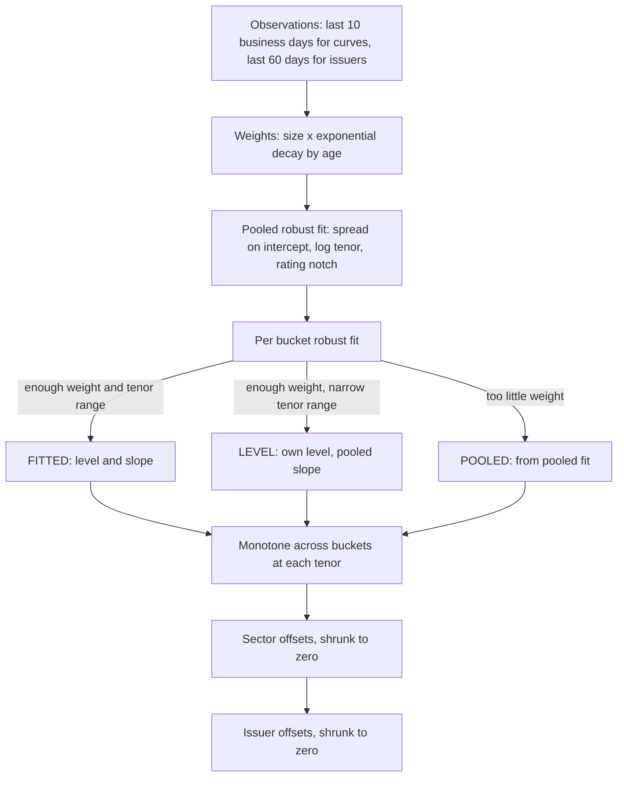

# Pricing methodology

The pricing service produces one evaluated mark per eligible bond per valuation date. Every mark records the method used, the evidence behind it and a confidence score. The method is scored daily against the next day's trades.

## Inputs

| Input | Source | Use |
|---|---|---|
| G-sec par curve | FBIL daily valuation (semi-annual par yields by tenor) | Risk-free discounting |
| Price observations | NSE bhavcopy weighted average price, validated by the trade flow service | Spread evidence |
| Cash-flow schedule | NSDL redemption and coupon schedule, merged in the golden record | Pricing schedule per date |
| Rating bucket, sector group, issuer key | Golden record (point-in-time ratings) | Curve segmentation |

## Eligibility

A security is marked when its golden record is eligible on the valuation date. The reference data service sets the reason when it is not:

| Reason | Rule |
|---|---|
| `MARKET_LINKED` | Coupon basis is index linked, or the description identifies a market linked debenture or a bond with a variable return |
| `FLOATING_RATE` | Coupon basis is variable or floating |
| `NO_SCHEDULE` | No cash-flow schedule in NSDL |
| `MATURED` | Final maturity before the valuation date |
| `SCHEDULE_DEFECT` | The NSDL schedule carries a critical warning: missing amounts, zero interest amounts on a coupon-bearing bond, or coupon amounts inconsistent with the stated rate |

## Risk-free curve

The FBIL par yields are bootstrapped into discount factors at half-year knots. Par yields between published tenors are interpolated linearly. A short knot at 0.25 years anchors the front end.

FBIL publishes par yields rounded to two decimals, out to 50 years. Bootstrapping rounded par yields can produce a discount factor that rises with maturity, which implies a negative forward rate. The bootstrap floors each discount factor at the previous one and reports the number of floored knots; on the 8 October 2026 curve two knots are floored, at 46.5 and 50 years.

The bond math is checked against FBIL's own G-sec valuation file for 8 October 2026: all 119 fixed-coupon G-secs reprice from FBIL's yield within 0.0006 per 100 of FBIL's price when settlement is T+1 and accrual is 30E/360. Five floating rate bonds are excluded from that check. The bootstrapped curve is checked by repricing each par point to 100.

## Price observations

The NSE bhavcopy reports one row per ISIN per trade date with the weighted average price and yield and the total face value traded. The trade flow service turns each row into an observation when all of the following hold:

1. The instrument is a bond with a weighted average price and yield.
2. The golden record exists and is eligible.
3. The yield recomputed from the reported price and the NSDL schedule is within 25 bp of the reported yield. Trades that fail this check are kept with a flag and are not used for pricing.

Rows with a total face value of at least ₹25 lakh are institutional. Smaller rows are retail and are weighted down in the curve fit.

For each observation the pricing service computes the z-spread over the bootstrapped curve, the bond's own yield and the risk-free par yield at the bond's tenor.

## Credit curve model

The model is refitted every valuation date from observations up to and including that date.



**Functional form.** For rating bucket `b` and tenor `t` in years, the bucket spread is `level_b + slope_b x ln(1 + t)`.

**Weights.** An observation's weight is its size weight (1.0 institutional, 0.25 retail) multiplied by `0.5^(age / half-life)`, where age is counted in business days. The half-life is 3 business days for curves and 15 for issuer offsets.

**Robust regression.** Each fit is weighted least squares with Huber weights (k = 1.345), using a scale from the median absolute deviation and up to 20 iterations. A single mispriced trade cannot move a bucket curve far.

**Bucket curves.** Buckets are AAA, AA+, AA, AA-, A+, A, A-, BBB (BBB+ to BBB-), SUB_IG and UNRATED. A bucket gets its own level and slope when its total weight is at least 6 and the log tenor range is at least 0.35. With enough weight but a narrow tenor range it gets its own level and the pooled slope. Otherwise its curve comes from the pooled fit evaluated at the bucket's representative notch.

**Monotonicity.** At each tenor, a bucket's spread is the maximum of its own curve and every better bucket's curve. A lower rating never prices tighter than a higher one. UNRATED is floored at the A- curve.

**Sector and issuer offsets.** The sector offset is the weighted mean residual of the sector's observations, shrunk towards zero with a prior weight of 5. The issuer offset is computed on residuals after the sector offset, with a prior weight of 1 and the longer issuer window. An issuer with a single recent trade therefore moves its other bonds only part of the way.

The model spread for a bond is `bucket curve(t) + sector offset + issuer offset`.

## Marking hierarchy

Each bond takes the first method that applies.

| Method | Condition | Spread used | Confidence |
|---|---|---|---|
| `TRADED` | Institutional trade on the valuation date | Own z-spread | 0.95 |
| `TRADED_RETAIL` | Only retail trades on the valuation date | 50% own retail spread, 50% model spread | 0.70 |
| `CARRIED` | Institutional trade in the last 30 calendar days | See below | max(0.5, 0.9 x decay) |
| `ISSUER_CURVE` | No own trade, issuer offset available | Model spread | 0.45 to 0.70 by issuer evidence weight |
| `MATRIX` | None of the above | Model spread | 0.20 to 0.40 by bucket fit strength |

Confidence is multiplied by 0.8 for SUB_IG and UNRATED bonds.

**Carried marks.** A bond that traded recently is marked in yield space:

```
carried yield = last traded yield + 0.25 x (risk-free par yield today - risk-free par yield on the trade date)
decay         = 0.5 ^ (business days since the trade / 20)
mark yield    = decay x carried yield + (1 - decay) x model yield
```

The pass-through of 0.25 was estimated on April to June 2026 consecutive trades of the same bond (regression slope 0.531, correlation 0.185) and fixed before the July to October test period, where the slope fell to 0.165. A full pass-through of the risk-free move, which is what carrying the spread unchanged implies, increased the error. Corporate yields in this market move much less than the G-sec curve over a few days.

**Evidence.** Each mark lists the trades it relies on: the bond's own trade with its decay weight, up to three recent trades of the same issuer, and the bucket curve with its source (`FITTED`, `LEVEL` or `POOLED`) and effective number of observations.

**Outputs.** For every mark: clean and dirty price, accrued interest, yield, z-spread, G-spread, modified duration, tenor, rating bucket, sector group, model spread, method, confidence and evidence. The model curves and sector offsets are stored per date.

## Daily backtest

Before marking date D, the service predicts the yield of every bond that traded institutionally on D, using only the model fitted on D-1 and observations up to D-1. The prediction uses the same hierarchy as marking, without the `TRADED` methods. For each prediction it also stores two naive baselines:

- **Last traded yield:** the bond's last institutional yield, unchanged.
- **Last spread, full pass-through:** the bond's last z-spread on today's curve.

The backtest is out of sample by construction: the trade being predicted is never in the data used to fit the model that predicts it.

## Parameters

| Parameter | Value |
|---|---|
| Curve window, half-life | 10 business days, 3 business days |
| Issuer window, half-life | 60 calendar days, 15 business days |
| Retail weight in fits | 0.25 |
| Minimum bucket weight, minimum log tenor range | 6.0, 0.35 |
| Sector shrinkage, issuer shrinkage | 5.0, 1.0 |
| Spread limits | abs(spread) at most 3,000 bp, tenor at least 0.1 years |
| Carry window, carry half-life, pass-through | 30 calendar days, 20 business days, 0.25 |
| Retail blend for `TRADED_RETAIL` | 0.5 |

Results are reported in [findings.md](../findings.md).

## Known limitations

- Callable and puttable bonds are priced to maturity. The reconciliation service identifies trades quoted to call or put, but the mark itself does not apply option-adjusted spreads.
- Bonds that have never traded, or whose issuer has not traded within 60 days, rely on the bucket curves. The backtest shows these marks are much less accurate (median error 55 bp), and their confidence scores reflect this.
- Ratings are mapped to the worst current long-term rating across agencies. Rating watch and outlook are not used.
- The model does not use the CCIL or RFQ order book, which would add quotes for bonds without trades.
