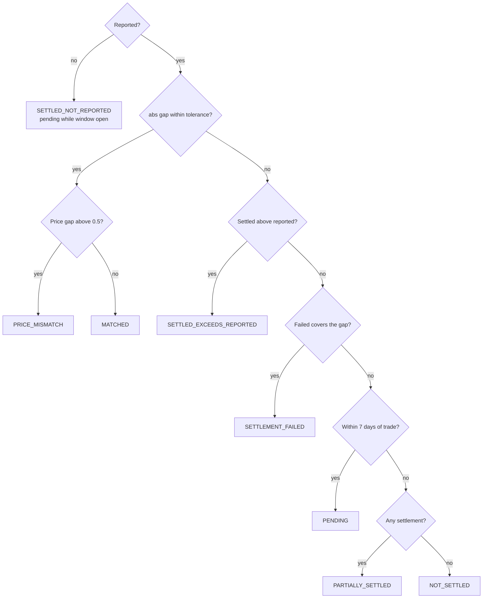
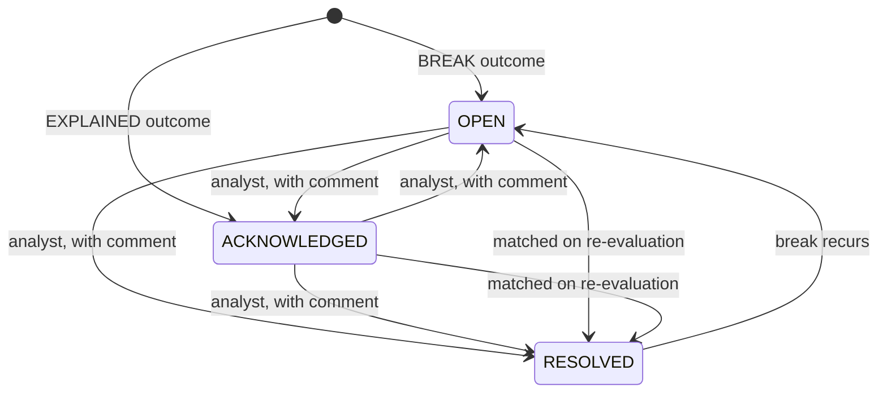

# Reconciliation controls

The recon service runs three controls at the end of each business date. Each control produces one outcome per key: `MATCHED`, `PENDING`, `EXPLAINED` or `BREAK`. Breaks are kept in a break book with a status workflow and are republished as events whenever they change.

| Control | Key | Compares |
|---|---|---|
| `TRADE_VS_SETTLEMENT` | ISIN and trade date | NSE reported face value and price against NSE Clearing settlement legs and fail records |
| `YIELD_RECOMPUTE` | ISIN and trade date | NSE reported yield against the yield recomputed from the reported price and the NSDL schedule |
| `REFDATA_SOURCES` | ISIN | NSDL coupon and maturity against the NSE security master |

## Trade to settlement

### Inputs

- **Reported:** one bhavcopy row per ISIN per trade date with total face value (the NSE "Total Trade Value" column is face value; on 13 October 2026 it matched settled nominal for 97% of ISINs) and weighted average price.
- **Settled:** NSE Clearing settlement files, one row per ISIN, trade date and settlement leg. Files are split by listing status (listed, unlisted) and counterparty class (mandatory and non-mandatory RFQ participants).
- **Failed:** NSE Clearing fail files with the face value that did not settle.

Settlement legs are attributed to their trade date, not to the settlement date. A trade date is re-evaluated on every business date for 10 calendar days after the trade.

### Rules

Tolerance on face value is the larger of ₹1 lakh and 0.5% of reported face.

The 7-day window comes from the observed settlement lag distribution: from January 2025 to October 2026, 64.3% of settlement rows settled T+0, 26.9% T+1, 1.6% T+2, 6.0% T+3 and 1.2% T+4. More than 99.99% settled within 7 calendar days. The remaining rows were 19 legs settled on 7 February 2025 against trade dates in August 2024.

Severity of a face value break is HIGH from ₹10 crore, MEDIUM from ₹1 crore and LOW below that.

The trade flow service applies the same rules to produce the trade lifecycle state per ISIN and trade date: `REPORTED`, `SETTLING`, `SETTLED`, `PARTIALLY_SETTLED`, `UNSETTLED`, `FAILED`, `OVER_SETTLED` and `SETTLED_UNREPORTED`.

### Interpreting results by instrument class

| Class | Pattern | Reason |
|---|---|---|
| Corporate bonds | 94.6% matched | Reported and settled through NSE |
| Certificates of deposit | Almost all `SETTLED_NOT_REPORTED` | CDs settle through NSE Clearing but most trades are reported on other platforms, not in the NSE bhavcopy |
| Commercial paper | Mixed | Partly reported on NSE, partly elsewhere |
| G-secs and T-bills | `NOT_SETTLED` | Reported on NSE but settled through CCIL, which is not in the clearing files |

The dashboard and the warehouse summary report each class separately. Only corporate bonds are used to measure the match rate.

## Yield recomputation

For each bhavcopy row with a weighted average price and yield, and an NSDL fixed coupon schedule, the service recomputes the yield to maturity from the price with T+0 settlement and the NSDL cash flows. A difference within 25 bp is `MATCHED`. Otherwise the service tests explanations in order and stops at the first that applies:

| Order | Outcome | Test |
|---|---|---|
| 1 | `EXPLAINED: QUOTED_TO_CALL` | Yield to the first call date is within 25 bp |
| 2 | `EXPLAINED: QUOTED_TO_PUT` | Yield to the first put date is within 25 bp |
| 3 | `EXPLAINED: SETTLEMENT_DATE_CONVENTION` | Yield with next business day settlement is within 25 bp |
| 4 | `EXPLAINED: PRICE_ON_ORIGINAL_FACE` | The bond has amortised and the price is quoted on original face; scaling the price by the outstanding fraction matches |
| 5 | `BREAK: SCHEDULE_DEFECT` | The NSDL schedule carries a critical warning |
| 6 | `BREAK: SCHEDULE_INCOMPLETE` | Undiscounted remaining cash flows are below the dirty price, so the schedule cannot produce a positive yield |
| 7 | `BREAK: YIELD_MISMATCH` | No explanation applies |

Each outcome carries the reported and recomputed yields, the difference and the value that explained it. `SCHEDULE_DEFECT` and `SCHEDULE_INCOMPLETE` point to a reference data problem at the depository rather than a trade problem.

Before this control was built, the convention it uses was measured on July to October 2026 data: median absolute difference 0.27 bp, 70.6% within 2 bp and 93% within 25 bp for rows with clean schedules, with T+0 settlement marginally closer than T+1.

## Reference data sources

For ISINs present in both NSDL and the NSE security master, the coupon rate (tolerance 0.005 percentage points) and maturity date are compared. A coupon difference is HIGH severity, a maturity difference is MEDIUM. The golden record also lists every field where sources disagree, with the value from each source.

## Break workflow

- The break id is `RECON_TYPE:ISIN:DATE`, so re-evaluating a trade date updates the same break instead of creating a new one.
- An automatic explanation sets the status to `ACKNOWLEDGED` with a note naming the explanation.
- Manual transitions go through `PATCH /api/v1/breaks/{breakId}` and require a comment. Invalid transitions return HTTP 409.
- `GET /api/v1/breaks/aging` returns open breaks per control by age bucket (0-1, 2-5, 6-10, 11-30 and over 30 calendar days).
- Each run stores evaluated, matched, explained, pending and break counts per control and date.
